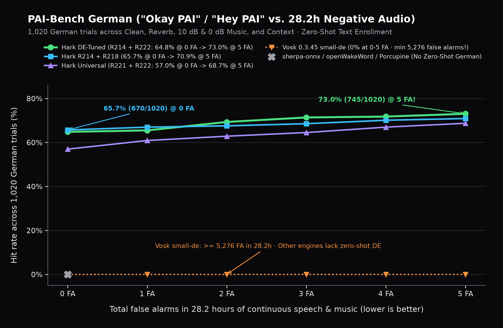
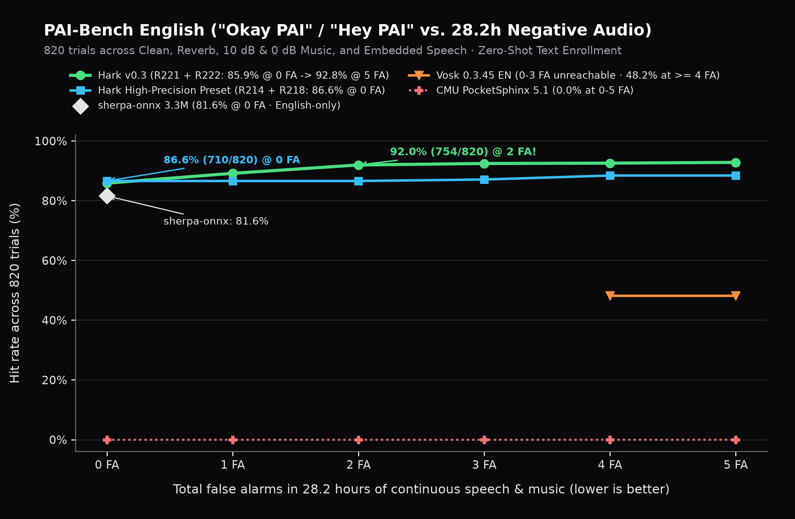

<p align="center">
  <picture>
    <source media="(prefers-color-scheme: dark)" srcset="docs/brand/hark-wordmark-white.svg">
    
  </picture>
</p>

**A zero-shot wake word engine for your own Jarvis: type a phrase, done. No recordings, no training.**

I originally built Hark for my own voice assistant, PAI. Its old wake-word engine (sherpa-onnx) is solid in English but basically deaf to "Okay PAI" in German, and every alternative wanted me to either record myself 50 times or burn two hours of Colab per word. Somehow that "quick weekend fix" turned into 220+ training runs, so I figured I might as well open-source it.

> **Alpha Preview (v0.3.0-alpha).** Runs on Linux x86_64 and ARM64 (Raspberry Pi 4/5, N100, mini PCs). It isn't optimised yet; faster builds, and maybe one day an ESP32 version, are on the list.

## Getting started

Hark only does the wake word part. Your voice assistant still needs speech-to-text and text-to-speech (the Whisper or Speech-to-Phrase app plus Piper work fine), and some device that streams its microphone to Home Assistant. If you get stuck anywhere, the [FAQ](docs/FAQ.md) probably has it.

### Home Assistant OS (easiest)

1. Go to Settings > Apps > Install app, open the three-dot menu in the top right, pick "Repositories" and add `https://github.com/pioborgelt/hark`.
2. Search the store for "hark", open Hark Wake Word and install it.
3. On the Configuration tab, add your phrases, for example `Hallo Kühlschrank:de` or `Hey Jarvis:en`. Save, then start the app from the Info tab.
4. Home Assistant should now find it by itself: Settings > Devices & services, under "Discovered", click Add on Hark Wake Word.
5. Open Settings > Voice assistants and your assistant. The wake word option is a bit hidden: it's in the three-dot menu of that dialog as "Add streaming wake word". Choose hark as the engine and your phrase as the wake word.

That's it. Say the phrase, pause for a beat, then say your command.

(If the menu points differ here or you can't follow the guide, please [open an issue](https://github.com/pioborgelt/hark/issues/new). I try to keep hark as accessible as possible.)

The app doesn't open a port on your host, so it happily runs next to openWakeWord.

### Docker (Home Assistant Container, Core, or another machine)

Start the Wyoming server with whatever English or German phrases you like, separated by `;`:

```bash
mkdir -p hark-data
docker run -d --name wyoming-hark --restart unless-stopped \
  -p 10400:10400 \
  -v "$PWD/hark-data:/data" \
  -e HARK_PHRASES="Hallo Kühlschrank:de;Hey Jarvis:en" \
  -e HARK_SENSITIVITY="balanced" \
  ghcr.io/pioborgelt/hark:alpha
```

You can also clone the repo and run `docker compose up -d`. On the first start it downloads about 31 MB of model weights into `./hark-data`.

Then add it in Home Assistant under Settings > Devices & services > Add integration > Wyoming Protocol, with the IP of the machine running the container and port 10400. Pick it in your assistant the same way as in step 5 above. If you have a Voice PE or another ESPHome device, switch its wake word setting from "On device" to "In Home Assistant".

### Python

No system packages needed: on Linux (x86_64 and ARM64) the pip packages bring eSpeak NG and libsndfile along.

```bash
pip install --index-url https://download.pytorch.org/whl/cpu "torch>=2.5,<3"
pip install "hark-ww[wyoming,microphone] @ git+https://github.com/pioborgelt/hark.git"

# try it live on your microphone, German and English at the same time
hark listen -p "Okay Haus:de" -p "Hey Jarvis:en"

# or run the Wyoming server for Home Assistant yourself
wyoming-hark --uri tcp://0.0.0.0:10400 --phrase "Okay Haus:de" --phrase "Hey Jarvis:en"
```

Or from your own code:

```python
from hark.streaming import HarkEngine

engine = HarkEngine(threads=2)
stream = engine.create_stream([
    engine.enroll("Okay Haus", language="de"),
    engine.enroll("Hey Jarvis", language="en"),
])

for hit in stream.push(audio_float32_16khz):
    print("Triggered:", hit["phrase"])
```

A word on picking phrases: three or four syllables with clear consonants ("Hey Jarvis", "Hallo Computer", "Smart Mirror") work a lot better than tiny words like "Ey" or "Yo". Unless you enjoy talking to your toaster by accident.

## Show us the graphs!

Every Hark number here is zero-shot. The model never heard the target word during training, not even as synthetic speech. I typed the phrase in and streamed 25 to 28 hours of speech, music and background noise through it without ever resetting the state.

### Picovoice wake word benchmark

This is the standard 24 hour benchmark with six words (alexa, computer, jarvis, smart mirror, snowboy, view glass), mixed with real noise at 10 dB SNR. Everything is compared at the same strict limit of 0.1 false alarms per hour, so roughly two false triggers a day.


| Engine | New word | Hit rate at 10 dB |
|---|---|---:|
| **Hark v0.3** | type text | **78.1%** |
| Snowboy | record samples | 68.1% |
| sherpa-onnx | type text (English only) | 66.0% |
| PocketSphinx | type text | 48.0% |
| Vosk (small) | type text | 32.7% |
| Porcupine v4 | closed source, API key | 97.3% |

On clean audio Hark gets 91.0%. That's 12 points ahead of sherpa-onnx, the best open-source zero-shot engine I could find, and it wins on five of the six words. It also beats the pre-trained openWakeWord models on the two words that exist for both: jarvis (78.4% vs 63.3%) and computer (64.2% vs 0%, where openWakeWord blows past the false alarm limit). Porcupine is still clearly ahead. I'll get there ;)

### The test I actually built it for: "Okay PAI"

28 hours of real English speech, German podcasts and music as negatives, then "Okay PAI" and "Hey PAI" spoken clean, in reverberant rooms and over loud music. Fair warning: the positives are synthetic voices, so read this as "does German work at all" rather than "how good is it on your mic". The Picovoice benchmark above is the one with real people.

In English Hark catches 85.9% without a single false alarm in 28 hours (92.0% if you allow two), sherpa-onnx gets 81.6%. In German it's 57.0% with zero false alarms and 62.8% with two. sherpa-onnx doesn't do German at all, and Vosk produced over 5,000 false alarms.

German is clearly the weaker language right now. If you have a few real recordings of a German wake word (yours, your kids', your Bavarian uncle's), that's the most useful thing you could send me.

<p align="center">
  
  
</p>

All the detailed tables and per-word numbers are in [docs/BENCHMARKS.md](docs/BENCHMARKS.md).

## How it works

Normal streaming wake word models only look backwards in time so they stay fast. The catch: in a noisy room, "he collects a..." sounds exactly like "Alexa" until you hear the syllable after it.

So Hark splits the job into two small models (details in [docs/ARCHITECTURE.md](docs/ARCHITECTURE.md)):

1. eSpeak turns your text into phonemes, plus the usual US, UK and German pronunciation variants, so you don't have to talk like a news anchor.
2. The first model (8.7 MB) runs all the time. It's a small causal Conv-GRU that listens for the phonemes of your phrase and costs almost nothing on a CPU. Most of the time the second model is asleep.
3. When the first model thinks it heard your phrase, Hark waits another 0.3 seconds and lets the second model (22 MB) look at the whole snippet, forwards and backwards. That throws out most of the look-alikes.

## Alpha heads-up and feedback

This is a really early alpha release and for now only English and German are supported. I mainly want to find out where it breaks on real microphones, weird room acoustics, and regional accents before polishing v0.4. Also, I'm building this in my free time, so keep your expectations relaxed: this isn't Porcupine (for now...).

It runs on your Home Assistant server or Pi, like openWakeWord does, and not directly on an ESP32 for now. If a phrase feels deaf, or it goes off whenever your washing machine beeps, have a look at the logs (Hark logs every near miss its second stage rejects) and [open an issue](https://github.com/pioborgelt/hark/issues/new) with your phrase, the language and your mic setup.

## License

The code is [MIT](LICENSE). The v0.3 alpha weights ([on Hugging Face](https://huggingface.co/Pioborgelt/hark)) are CC BY-NC 4.0, so they're free for personal use, Home Assistant setups, tinkering and research. They were trained on open speech and noise datasets (MLS, LibriSpeech, VoxPopuli, Common Voice, MUSAN) plus synthetic speech generated with Google Gemini TTS.
