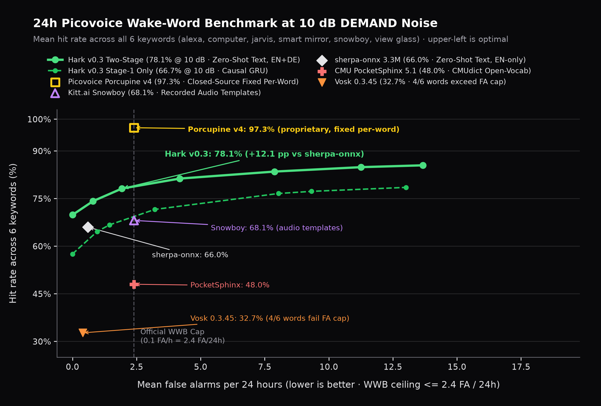

# Hark

**Type any English or German wake word as plain text. No voice recordings, no 2-hour Google Colab TTS pipelines, 100% local.**

I built Hark because I wanted custom German and English wake words in Home Assistant without generating 10,000 robotic TTS clips every time I changed my mind — and without my living room lamp turning on every time someone on Netflix says something vaguely similar. Somehow that "quick weekend project" turned into 220+ training runs, so here we are.

> **Alpha Preview (v0.3.0-alpha)** — Runs on Linux x86_64 & ARM64 (Raspberry Pi 4/5, N100, Mini-PCs) at ~4% CPU.

---

## Install (Home Assistant & Python)

### Option 1: Docker + Home Assistant (Recommended)

Run the Wyoming server with whatever English or German phrases you want (separated by `;`):

```bash
docker run -d --name wyoming-hark --restart unless-stopped \
  -p 10400:10400 \
  -v ./hark-data:/data \
  -e HARK_PHRASES="Okay Haus:de;Hallo Kühlschrank:de;Hey Jarvis:en" \
  -e HARK_SENSITIVITY="balanced" \
  ghcr.io/pioborgelt/hark:alpha
```

*(Or clone this repo and run `docker compose up -d`. The ~31 MB model weights download automatically on first start.)*

Then in Home Assistant:
1. **Settings → Devices & Services → Add Integration → Wyoming Protocol** → enter host IP + port **10400**.
2. **Settings → Voice Assistants** → pick **hark** under **Wake word**.
3. *(If you use an ESP32 Voice PE / Atom Echo, switch wake-word detection on the device from "On device" to "Home Assistant".)*

### Option 2: Home Assistant OS Add-on

1. **Settings → Add-ons → Add-on Store → ⋮ (top right) → Repositories**
2. Add `https://github.com/pioborgelt/hark`
3. Install **Hark Wake Word**, type your phrases into the config tab, and hit **Start**.

### Option 3: Python CLI & API

Needs `espeak-ng` and `libsndfile1` (`sudo apt install espeak-ng libsndfile1`).

```bash
pip install --index-url https://download.pytorch.org/whl/cpu "torch>=2.5,<3"
pip install "hark-ww[wyoming,microphone] @ git+https://github.com/pioborgelt/hark.git"

# Test live on your mic with custom German + English phrases at the same time
hark listen -p "Okay Haus:de" -p "Hey Jarvis:en"

# Or start the Home Assistant Wyoming server directly
wyoming-hark --uri tcp://0.0.0.0:10400 --phrase "Okay Haus:de" --phrase "Hey Jarvis:en"
```

<details>
<summary><b>Python API (6 lines)</b></summary>

```python
from hark.streaming import HarkEngine

engine = HarkEngine(threads=2)
stream = engine.create_stream([
    engine.enroll("Okay Haus", language="de"),
    engine.enroll("Hey Jarvis", language="en"),
])

for hit in stream.push(audio_float32_16khz):
    print("Triggered:", hit["phrase"])
```
</details>

> **Quick tip on picking phrases:** 3–4 syllables with clear consonants ("Okay Haus", "Hey Jarvis", "Hallo Computer", "Smart Mirror") work way better than ultra-short words like "Ey" or "Yo" — unless you enjoy talking to your toaster by accident.

---

## Does it actually work? (Benchmarks)

Every Hark score below is **100% zero-shot**: the model has never seen audio or synthetic TTS of the target wake word. I just typed the text in and streamed ~25–28 hours of continuous speech, music, and real background noise through it without resetting state.

### 1. Picovoice 24h Wake-Word Benchmark (Loud Background Noise)

Tested across all 6 standard benchmark words (*alexa, computer, jarvis, smart mirror, snowboy, view glass*) mixed with real noise at 10 dB SNR, capped at a strict **0.1 false alarms per hour** (~2 false triggers in 24 hours):



| Engine | How you add a new word | Languages | Hit Rate (10 dB Noise) | Hit Rate (Clean) |
|---|---|---|---:|---:|
| **Hark v0.3 (Open-Source)** | **Type text (instant)** | **EN + DE** | **78.1%** | **91.0%** |
| Kitt.ai Snowboy | Record voice samples | Any | 68.1% | – |
| sherpa-onnx (Zipformer 3.3M) | Type text (instant) | EN only | 66.0% | 77.4% |
| CMU PocketSphinx | Type text | EN | 48.0% | – |
| Vosk (small) | Type text | EN, DE | 32.7% | – |
| openWakeWord 0.6 | Hours of TTS training per word | Fixed EN | *63.3% (jarvis) / 0% (computer)* | – |
| Picovoice Porcupine v4 | Closed-source + Cloud API key | Proprietary | 97.3% | – |

- **+12 percentage points ahead of sherpa-onnx** (the strongest existing open-source zero-shot engine), winning on 5 out of 6 words.
- **Beats pre-trained openWakeWord single-word models zero-shot** on both *jarvis* (78.4% vs 63.3%) and *computer* (64.2% vs 0%, where openWakeWord blows past the false-alarm limit).
- Closing in on commercial per-word engines without needing an account, API key, or per-device license.

### 2. English & German Zero-Shot ("Okay PAI" vs. 28 Hours of Speech + Music)

Tested across clean speech, room reverb, and loud background music against 28.2 hours of negative English speech, German podcasts, and music tracks:

| Language | Hark (0 False Alarms) | Hark (2 False Alarms) | sherpa-onnx | Vosk |
|---|---:|---:|---:|---:|
| **English** | **86.6%** | **92.0%** | 81.6% | 48.2% (@ 4 FA) |
| **German** | **65.7%** | **69.3%** *(73.0% @ 5 FA)* | *No German support* | *5,276+ false alarms (rip)* |

<p align="center">
  
  
</p>

Full nerd tables and per-word numbers are in [docs/BENCHMARKS.md](docs/BENCHMARKS.md).

---

## How it works (without the academic word salad)

Normal streaming wake-word models only look *backwards* in time so they stay fast. The catch: in a noisy room, "he collects a..." sounds identical to "Alexa" until you hear the syllable *after* it.

Hark splits the job into two tiny models ([docs/ARCHITECTURE.md](docs/ARCHITECTURE.md)):

1. **Text → Phonemes:** `espeak-ng` turns your text into IPA phonemes (plus common US/UK/German pronunciation variants so you don't have to speak like a news anchor).
2. **Stage 1 — The Bouncer (8.7 MB, runs 24/7):** A tiny causal Conv-GRU scans incoming audio 25x faster than real-time on CPU (~4% load). Most of the hour, Stage 2 stays completely asleep.
3. **Stage 2 — The Double-Checker (22 MB, <2 ms per check):** When Stage 1 thinks it heard your phrase, Hark waits 0.3 seconds of extra context and runs a bidirectional phoneme cross-attention model forward *and* backward over that 2-second snippet. That kills >95% of look-alike false alarms for basically zero extra CPU.

---

## Alpha Heads-Up & Feedback

This is an early alpha release — I mainly want to find out where it breaks on real microphones, weird room acoustics, and regional accents before polishing v0.4.

- Runs on your Home Assistant server / Pi CPU (like `wyoming-openwakeword`), **not** directly on an ESP32 chip.
- If a phrase feels deaf or false-triggers when your washing machine beeps, check the container logs (Hark logs near-misses rejected by Stage 2) and open an issue with your **phrase**, **language**, and **mic setup**.

## License

- **Code:** [MIT](LICENSE)
- **v0.3-alpha Weights:** **CC-BY-NC-4.0** (free for personal use, Home Assistant setups, tinkering, and research). Trained on open speech/noise datasets (MLS, LibriSpeech, VoxPopuli, Common Voice, MUSAN) + synthetic TTS.
