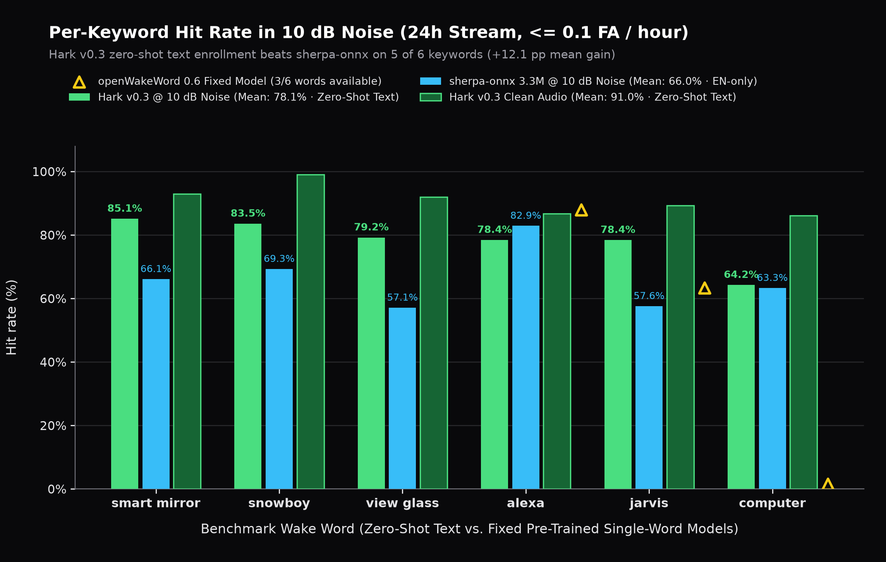

# Hark — Zero-Shot Text-Enrolled Wake-Word Engine (EN + DE)

**Type any English or German wake phrase as plain text (`"Okay Haus"`, `"Hey Jarvis"`, `"Smart Mirror"`). Zero audio samples. Zero Colab training. 100 % local (~31 MB total weights, ~4 % CPU on 2 threads).**

> **Status: `v0.3.0-alpha` (Research Preview)** — Built for Home Assistant (*Assist* via Wyoming Protocol) and local Python voice pipelines. Tested on x86_64 and ARM64 (Raspberry Pi 4/5, N100, Linux).

---

## Quickstart: Add to Home Assistant in 60 Seconds

### Option A: Docker / Docker Compose (Recommended)

```bash
git clone https://github.com/pioborgelt/hark.git
cd hark
docker compose up -d
```

Or as a single `docker run` command with your own custom German and/or English wake phrases:

```bash
docker run -d --name wyoming-hark --restart unless-stopped \
  -p 10400:10400 \
  -v ./hark-data:/data \
  -e HARK_PHRASES="Okay Haus:de;Hallo Computer:de;Hey Jarvis:en" \
  -e HARK_SENSITIVITY="balanced" \
  ghcr.io/pioborgelt/hark:alpha
```

*(Model weights — `8.7 MB` Stage-1 + `22 MB` Stage-2 — download automatically into `/data/models` on first start.)*

**Connect in Home Assistant:**
1. Go to **Settings → Devices & Services → Add Integration → Wyoming Protocol**
2. Enter your Docker host IP and port **`10400`**
3. Go to **Settings → Voice Assistants**, open your Assist pipeline, and select **`hark`** + any of your configured phrases under **Wake word**.
   *(Using an ESP32 Voice PE or Atom Echo satellite? Switch wake-word processing on the satellite device from "On device" to **"Home Assistant"** so audio streams to Hark.)*

### Option B: Home Assistant OS (HAOS) Add-on

1. In Home Assistant, open **Settings → Add-ons → Add-on Store → ⋮ (top right) → Repositories**
2. Add `https://github.com/pioborgelt/hark`
3. Install **Hark Wake Word (Zero-Shot EN/DE)**, enter your phrases (`Okay Haus:de`, `Hey Jarvis:en`) in the **Configuration** tab, and click **Start**.

---

## Quickstart: Python CLI & Library

System prerequisite: `espeak-ng` and `libsndfile1` (`sudo apt install espeak-ng libsndfile1` on Debian/Ubuntu).

```bash
pip install --index-url https://download.pytorch.org/whl/cpu "torch>=2.5,<3"
pip install "hark-ww[wyoming,microphone] @ git+https://github.com/pioborgelt/hark.git"
```

```bash
# 1. Listen live on your microphone (multiple EN + DE phrases simultaneously!)
hark listen -p "Okay Haus:de" -p "Hey Jarvis:en"

# 2. Stream a WAV/FLAC recording and print detections + CPU Real-Time Factor
hark detect recording.wav -p "Okay Haus:de"

# 3. Inspect how eSpeak maps your custom phrase into IPA phoneme variants
hark phones "Okay Kühlschrank:de" "Smart Mirror:en"

# 4. Run the Home Assistant Wyoming TCP server directly
wyoming-hark --uri tcp://0.0.0.0:10400 --phrase "Okay Haus:de" --phrase "Hey Jarvis:en"
```

**6-Line Python Streaming API:**

```python
from hark.streaming import HarkEngine

engine = HarkEngine(threads=2)  # auto-downloads ~31 MB Stage-1 + Stage-2 weights
stream = engine.create_stream([
    engine.enroll("Okay Haus", language="de", sensitivity="balanced"),
    engine.enroll("Hey Jarvis", language="en", sensitivity="balanced"),
])

for event in stream.push(float32_16khz_chunk):  # or stream.push_pcm16(pcm_bytes)
    print(f"Detected {event['phrase']} (score={event['combined_score']:.2f})")
```

> **Tip for picking custom wake phrases:** 3–4 syllables with crisp plosives/fricatives (`"Okay Haus"`, `"Hey Jarvis"`, `"Hallo Computer"`, `"Smart Mirror"`) separate cleanly from TV/music background speech. Very short 2-syllable or vowel-heavy words need higher thresholds (`--sensitivity strict`). Check startup logs (`ipa=['/okehaʊs/']`) if an unusual proper noun is pronounced unexpectedly.

---

## Benchmarks: How Hark Compares to Existing Wake-Word Engines

Unlike `openWakeWord` or `microWakeWord` (which require multi-hour synthetic TTS training pipelines for every single custom word and ship fixed English models), **every Hark result below is 100 % zero-shot from plain text** — zero audio samples of the target phrase, evaluated in uninterrupted continuous streaming (`reset = 0`).

### 1. Picovoice 24-Hour Wake-Word Benchmark (`10 dB` DEMAND Noise, `<= 0.1 FA/h`)

Evaluated across all 6 standard benchmark keywords (`alexa`, `computer`, `jarvis`, `smart mirror`, `snowboy`, `view glass`) embedded in ~24.8 hours of continuous speech + 17 real DEMAND noise environments at **`10 dB` SNR** per word (~149 hours per condition) at the strict official ceiling of **`<= 0.1` false alarms per hour (`<= 2.4 FA / 24h`)**:


| Engine | Enrollment / Category | Languages | Hit Rate @ `10 dB` (`<= 0.1 FA/h`) | Clean Hit Rate | Custom Word Setup |
|---|---|---|---:|---:|---|
| **Hark v0.3 (Two-Stage)** | **Zero-Shot Text (Open-Source)** | **EN + DE** | **`78.1 %`** *(75.4 % single setting)* | **`91.0 %`** | **Instant (type text)** |
| `Kitt.ai Snowboy` | Recorded Audio Templates | Template | `68.1 %` *(published)* | – | Record voice samples |
| **Hark v0.3 (Stage-1 Only)** | **Zero-Shot Text (Causal GRU)** | **EN + DE** | **`66.7 %`** | **`80.3 %`** | **Instant (type text)** |
| `sherpa-onnx` 3.3M (Zipformer) | Zero-Shot Text (Open-Source) | EN only | `66.0 %` | – | Instant (English only) |
| `CMU PocketSphinx` 5.1.1 | Open-Vocab CMUdict | EN | `48.0 %` *(published)* | – | Instant (high FA rate) |
| `Vosk` 0.3.45 (`small-en`) | Open-Vocab ASR Grammar | EN, DE | `32.7 %` *(4/6 fail FA cap)* | – | Instant (fails FA cap) |
| `openWakeWord` 0.6.0 | Fixed Single-Word ONNX | Fixed EN | *3/6 words (`87.9 / 63.3 / 0 %`)* | – | Hours of TTS Colab training |
| `Picovoice Porcupine` v4 | Closed-Source Fixed Per-Word | Proprietary | `97.3 %` *(published)* | – | Cloud Console + API Key |



- **Beats `sherpa-onnx` by `+12.1` percentage points** (`78.1 %` vs. `66.0 %`) and wins on **5 out of 6 keywords** (`smart mirror` `85.1 %` vs `66.1 %`, `snowboy` `83.5 %` vs `69.3 %`, `view glass` `79.2 %` vs `57.1 %`, `jarvis` `78.4 %` vs `57.6 %`, `computer` `64.2 %` vs `63.3 %`).
- **Outperforms fixed `openWakeWord` models zero-shot** on `jarvis` (`78.4 %` vs `63.3 %`) and `computer` (`64.2 %` vs `0.0 %`, where `openWakeWord` exceeds the `0.1 FA/h` ceiling).
- **Beats recorded-template `Snowboy` by `+10.0` points** without recording a single audio sample.

---

### 2. Bilingual Zero-Shot Benchmark: English & German (`PAI-Bench` vs. 28.2h Speech + Music)

Evaluated on `"Okay PAI"` / `"Hey PAI"` across clean speech, room reverb, `10 dB` & `0 dB` music interference, and embedded continuous-speech sentences against **28.19 hours** of negative English speech, German speech, and full music tracks:

| Benchmark | **Hark (`0 FA` in 28.2h)** | **Hark (`2 FA` in 28.2h)** | **Hark (`5 FA` in 28.2h)** | `sherpa-onnx` 3.3M | `Vosk` 0.3.45 | `PocketSphinx` 5.1 |
|---|---:|---:|---:|---:|---:|---:|
| **English (`820` trials)** | **`86.6 %`** (`85.9 %` v0.3) | **`92.0 %`** (`754/820`) | **`92.8 %`** (`761/820`) | `81.6 %` (`0 FA`) | *unreachable* (`48.2 %` @ 4 FA) | `0.0 %` |
| **German (`1,020` trials)** | **`65.7 %`** (`670/1020`) | **`69.3 %`** (`707/1020`) | **`73.0 %`** (`745/1020`) | *no German support* | *min. 5,276 FAs!* | *no German* |


Full per-model breakdowns: [docs/BENCHMARKS.md](docs/BENCHMARKS.md).

---

## How It Works: Two-Stage Phoneme Architecture

Why do single-pass causal CTC / ASR keyword spotters hit a wall at `0.1 FA/hour`? Because a strictly causal encoder seeing `"collects a"` in 10 dB noise cannot look ahead at post-offset coarticulation before deciding whether `"alexa"` occurred.

Hark solves this with a split **Always-On Causal Stage 1 + Event-Triggered Bidirectional Stage 2** pipeline ([docs/ARCHITECTURE.md](docs/ARCHITECTURE.md)):

1. **Deterministic Multi-Pronunciation IPA (`hark/text.py`):** Maps English or German text via `espeak-ng` into IPA phoneme sequences, automatically expanding common pronunciation variants (US/UK vowels, alveolar flap `ɾ -> t`, German `/oke/` vs. `/okɛɪ/`).
2. **Stage 1 — Causal Dilated-Conv + 2-Layer GRU + Confident-Frame CTC Trellis (`8.7 MB`, `50 Hz`):** Runs continuously on 16 kHz audio (`RTF ~0.04` on 2 CPU threads = **25x faster than real-time**), trained on uninterrupted 14-second speech/music/noise stream beds with carried recurrent state. Shared across all enrolled phrases simultaneously.
3. **Stage 2 — `BiPhonemeVerifier` (`22 MB`, `< 0.05 %` duty cycle):** Triggered **only** when Stage 1 spots a candidate (~once per several minutes of speech). Waits `~320 ms` (`16` lookahead frames) to inspect a `~2.2 s` window around the candidate using a 3-layer **bidirectional** dilated-conv + BiGRU + 2-layer phoneme-to-frame cross-attention discriminator and forced CTC span alignment. Rejects >95 % of causal look-alike false alarms while adding zero steady-state CPU load.

---

## Alpha Limitations & Reporting Feedback

We are publishing `v0.3.0-alpha` early to gather real-world microphone, room-acoustics, and accent feedback from the Home Assistant community:

- **Host CPU engine (not on-device ESP32):** Like `wyoming-openwakeword`, Hark runs on your Home Assistant server / Raspberry Pi / Mini-PC (`~4 %` of 2 CPU cores), not on an ESP32 microcontroller.
- **Short words vs. multi-syllable phrases:** 3–4 syllable phrases (`"Okay Haus"`, `"Smart Mirror"`, `"Hey Jarvis"`) perform substantially better than short vowel-heavy words.
- **Built-in Near-Miss Diagnostics:** By default, `wyoming-hark` logs Stage-1 candidates rejected by Stage-2 (`Near-miss rejected by Stage-2: phrase="Okay Haus" combined=-0.12 < 0.15 ...`). If a phrase feels deaf or false-triggers in your living room, open an issue with:
  1. Your **phrase + language** (and the `ipa=[...]` startup log line)
  2. Your **microphone / satellite hardware** (e.g. HA Voice PE, Atom Echo, ReSpeaker, USB mic)
  3. Relevant `DETECTED` or `Near-miss` log lines (optionally set `HARK_DEBUG_CLIP_DIR=/data/debug_clips` to capture local 3s WAV snippets).

---

## License

- **Source code:** [MIT License](LICENSE).
- **Pre-trained v0.3-alpha model weights (`hark-stage1-r221-h384.pt`, `hark-stage2-r222-v384.pt`):** Released under **CC-BY-NC-4.0** (free for personal, Home Assistant, academic, and research use). Trained on open speech & noise corpora ([Multilingual LibriSpeech](https://huggingface.co/datasets/facebook/multilingual_librispeech) CC-BY-4.0, [LibriSpeech](https://www.openslr.org/12) CC-BY-4.0, [MUSAN](https://www.openslr.org/17/) CC-BY-4.0, [VoxPopuli](https://github.com/facebookresearch/voxpopuli) CC0, [Common Voice 17](https://commonvoice.mozilla.org/) CC0) plus synthetic TTS augmentation.
